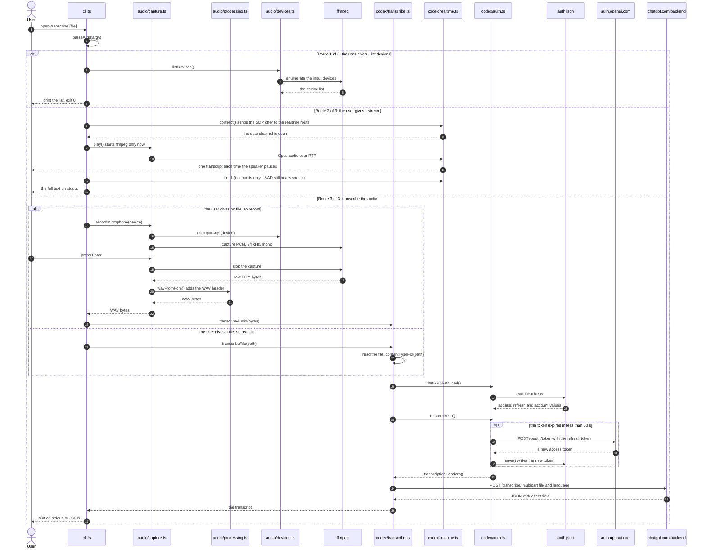
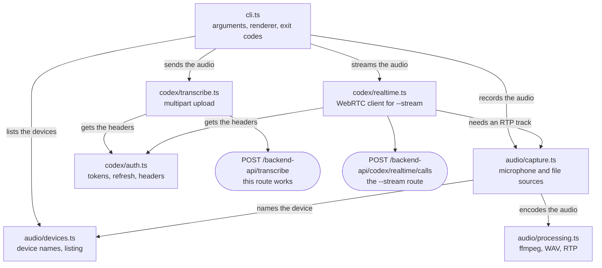

# How open-transcribe works

`open-transcribe` changes speech into text. It uses the ChatGPT credentials that
`codex login` writes to disk. It does not need an OpenAI API key.

## How to read the diagrams

The sequence diagram uses three labels from the sequence-diagram standard.
The text in brackets after each label gives the condition.

| Label | Meaning |
|---|---|
| `alt` and `else` | Alternative routes. Only one route runs. |
| `opt` | An optional step. It runs only if the condition is true. |
| The numbers | The order of the steps. |

## The upload path

The diagram shows one run of the CLI from start to end.
A run takes one of three routes. Routes 2 and 3 do the transcription.

## Module map

Each module does one job.

## Points to remember

- `cli.ts` never sends audio. `codex/transcribe.ts` or `codex/realtime.ts`
  sends it.
- `cli.ts` imports through `audio/index.ts` and `codex/index.ts`. Each
  folder gives one surface; the files behind it can move.
- `codex/auth.ts` refreshes the token 60 seconds before it expires. This
  prevents a failure in the middle of a session.
- The desktop shortcut uses `desktop/recording.ts` to open a microphone for each
  press. On 64-bit Windows, `desktop/microphone.ts` uses WinMM to capture
  24 kHz mono PCM directly, without starting ffmpeg or a DirectShow graph.
  Recording starts only after the first audio buffer arrives. Releasing the
  shortcut returns the final partial buffer and closes the device.
  If the input buffers fill before they can be drained, the recording is
  rejected instead of uploading audio with gaps.
- Native capture requires a unique, exact device-name match. Truncated names,
  ambiguous names, and devices that fail native initialization use ffmpeg.
  The command line capture paths and device listing also use ffmpeg.
- The microphone in the Codex Desktop composer uses the upload route. It does
  not use WebRTC.
- The realtime route returned 404 for a period. It worked again on
  2026-10-31.
- In `--stream`, start ffmpeg only after the data channel opens. Audio sent
  before that is lost.
- Do not commit a buffer of silence. The model then invents text, for
  example "Lütfen gel."
