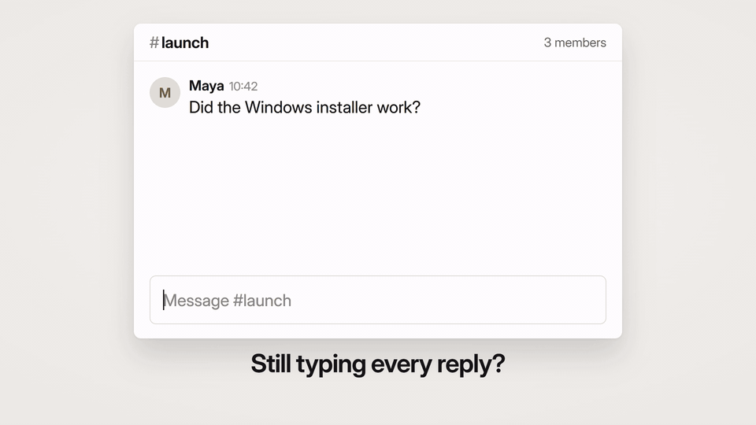

<div align="center">


# open-transcribe

**Hold a key. Speak. Your words appear in any app.**

Speech-to-text for Windows that uses your ChatGPT subscription.
You do not need an API key. You do not pay for each minute.

[](#install)
[](https://bun.sh)
[](https://tauri.app)
[](ts/)

[**Download**](https://github.com/kelpikz/open-transcribe/releases/latest) ·
[How it works](#how-it-works) ·
[Command line](#command-line) ·
[Build from source](#build-from-source)

<br />



<sub>[Watch it with sound (MP4)](docs/demo.mp4)</sub>

</div>

---

## Why open-transcribe?

- 🎙️ **Dictate anywhere.** Hold the shortcut in Slack, VS Code, your browser,
  or any other app. Release it, and the text is typed where your cursor is.
- 💳 **Uses the plan you already have.** Sign in with `codex login`. The app
  uses the same transcription that the Codex Desktop microphone button uses.
- 🪶 **Small and quiet.** A small pill at the bottom of the screen shows a live
  waveform and a timer. It does not take focus, so your text goes to the
  correct window.
- 🔒 **Private by default.** The microphone is open only while you hold the
  shortcut. The app does not save your text. It keeps only the last text in
  memory, for **Copy it again**.
- 📋 **Keeps your clipboard.** After the paste, the app puts your old
  clipboard content back. Clipboard history (Win+V) does not keep the text.
- ⌨️ **Also a command line tool.** Transcribe audio files, record from the
  terminal, or stream the text while you speak.

## Install

1. Install [ffmpeg](https://ffmpeg.org/download.html) and make sure that it is
   on your `PATH`. The app uses it to list microphones and as a recording fallback.
2. Install the [Codex CLI](https://github.com/openai/codex) and sign in:

   ```bash
   codex login        # choose "Sign in with ChatGPT"
   ```

3. Download the installer from the
   [latest release](https://github.com/kelpikz/open-transcribe/releases/latest)
   and run it.

## Use it

1. Hold **Ctrl + Shift + Space**.
2. Wait until the dot in the pill turns red. Then speak.
3. Release the keys. The text is pasted into the window that you work in.

If the desktop or the taskbar is in front, the app copies the text to the
clipboard and does not paste it.

If an error occurs, the pill shows a short message for six seconds. Open the
settings window for details.

### Settings

The app has one settings window. Use the tray icon to open it. At the top, it
shows how to dictate. If something is wrong (you are signed out, ffmpeg is
missing, or there is no microphone), it shows the problem and the fix.

You can change:

| Setting | Options |
|---|---|
| Shortcut | Any key combination |
| Language | Auto, or a specific language |
| Microphone | Any input device |
| After you speak | Paste the text, or copy it only |
| Start with Windows | On or off |
| Sounds | On or off |

Closing the window hides it. To quit, use the tray icon. Only one copy of the
app runs at a time. Settings are in
`%APPDATA%\com.kelpikz.codex-audio\settings.json`.
The app keeps this identifier so existing settings remain available after the rename.

## How it works

```
 Hold shortcut ──► Microphone (ffmpeg) ──► Release ──► Upload clip
                                                           │
     Paste into your app ◄── Text ◄── chatgpt.com/backend-api/transcribe
```

The microphone button in Codex Desktop records a clip, then uploads it to this
route:

```http
POST https://chatgpt.com/backend-api/transcribe
Authorization: Bearer <token from ~/.codex/auth.json>
ChatGPT-Account-Id: <account id>
Content-Type: multipart/form-data

file=<audio recording>
language=en
```

open-transcribe uses the same route and the same ChatGPT sign-in. The desktop app
is a [Tauri](https://tauri.app) shell. A [Bun](https://bun.sh) process runs in
the background and does the recording, the upload, and the paste. For more
information, see [ARCHITECTURE.md](ARCHITECTURE.md).

The desktop app records directly through Windows when the selected microphone
supports it. Other microphones use ffmpeg. Both paths close the microphone when
you release the shortcut.

## Command line

The command line tool works on all platforms where Bun and ffmpeg work.
`--listen` works only on Windows.

```bash
cd ts
bun install
bun run start                      # speak, press Enter, print the text
bun run start meeting.wav          # transcribe an audio file
bun run start --json meeting.wav   # print {"text": "..."}
bun run start --stream             # show the text while you speak
bun run start --listen             # Windows: hold Ctrl+Shift+Space to dictate anywhere
```

To make a single executable file, run `bun run build`. It writes
`dist/open-transcribe`.

<details>
<summary><b>All options</b></summary>

| Option | Effect |
|---|---|
| *(no input)* | Record from the default microphone until you press Enter |
| `<file>` | Upload and transcribe an audio file |
| `--device N` | Select a microphone (`--list-devices` shows the devices) |
| `--language`, `-l` | Send an ISO-639-1 language hint. `auto` sends no hint |
| `--json` | Print `{"text": "..."}` |
| `--quiet`, `-q` | Do not show progress on stderr |
| `--stream` | Stream over WebRTC and show each part when you pause |
| `--listen` | Windows: hold the hotkey to dictate into the window in front |
| `--hotkey KEYS` | The `--listen` hotkey (default `ctrl+shift+space`) |

These options change only `--stream`: `--model`, `--prompt`, `--silence-ms`,
`--noise-reduction`, `--no-partials`, `--raw-events`, `--session` (a JSON file
that replaces the session payload), and `--drain` (seconds to wait for the
last text, default 10).

If your console font cannot show the `…`, `✓` and `─` characters, set
`OPEN_TRANSCRIBE_ASCII=1`.

</details>

<details>
<summary><b>More about <code>--listen</code></b></summary>

`--listen` runs in the background until you press Ctrl+C in its console.

- The microphone stays open while `--listen` runs, and Windows shows the
  microphone icon. A microphone takes about 0.6 s to open, so your first words
  would be lost if it opened at each key press. The app keeps audio only while
  you hold the hotkey, plus the last 0.3 s before it.
- The app does not send a hold shorter than 0.3 s, or a clip with no sound.
- The app waits up to three seconds for you to release all keys. If a key
  stays down, or focus moves to another window, the app copies the text and
  does not paste it.
- A hotkey is a list of keys joined with `+`: `ctrl`, `shift`, `alt`, `win`,
  their left and right forms (`lctrl`, `rwin`, ...), `space`, `tab`,
  `capslock`, `insert`, `pause`, `scrolllock`, `a`–`z`, `0`–`9`, `f1`–`f24`.
- With a `win` hotkey, the app sends an unused key (`vkE8`), so the Start menu
  does not open when you release the keys.
- An app that runs as administrator does not accept a paste from a normal
  process. For those apps, run open-transcribe as administrator.

</details>

<details>
<summary><b>More about <code>--stream</code></b></summary>

`--stream` uses a different route, `/backend-api/codex/realtime/calls`. It
sends the audio over WebRTC. The server finds the pauses in your speech and
sends back the text for each part. This route returned 404 for a period. It
worked again on 2026-10-31.

</details>

## Build from source

You need [Bun](https://bun.sh), [Rust](https://rustup.rs) (for Tauri), and
ffmpeg on your `PATH`.

```bash
cd app
bun install
bun run dev      # build the sidecar, then start the app
bun run build    # build the sidecar, then make the installer
```

To make a release, set the same version in `app/package.json`,
`app/src-tauri/tauri.conf.json` and `app/src-tauri/Cargo.toml`. Update the Cargo
lockfile and add notes in `docs/releases/vVERSION.md`. Run
`bun run check:release` in `app` to check that the versions and notes match.
After merging, push the matching tag, such as `v0.1.1`. GitHub Actions checks
the tag and makes a signed draft release with the notes, installer, and update
files. Publish the draft, and the app offers the update.

To run the tests:

```bash
cd ts
bun test
```

To measure the time until the first audio arrives on Windows, run
`bun run benchmark:startup` in `app`. The benchmark compares ffmpeg with desktop
capture over fifteen recordings each. It discards the audio without uploading it.
Pass a microphone name as an argument to measure a specific input.

Every pull request also runs `bun run test:startup` from `app` against controlled
audio, with a fixed startup budget and saved measurements. See
[Desktop startup performance checks](docs/startup-performance.md) for the limits
and the difference between CI measurements and microphone hardware timing.

To include the native capture stress test, set
`OPEN_TRANSCRIBE_TEST_MICROPHONE=1` before running `bun test` in `ts`. This opens the
microphone for about three seconds and checks that garbage collection does not
interrupt recording. The test discards the audio without uploading it.

<details>
<summary><b>Project files</b></summary>

| Path | What it does |
|---|---|
| `ts/src/cli.ts` | Argument parsing and entry point |
| `ts/src/renderer.ts` | Terminal output |
| `ts/src/audio/` | Microphone and file input, ffmpeg, WAV encoding, devices |
| `ts/src/codex/` | Codex sign-in, file upload, WebRTC client for `--stream` |
| `ts/src/listen.ts` | `--listen`: hotkey, clips, paste or copy |
| `ts/src/desktop/win32.ts` | Windows calls: keys, foreground window, clipboard, sounds |
| `ts/src/sidecar.ts` | Background process of the desktop app |
| `app/src-tauri/src/main.rs` | Tauri shell: sidecar, pill window, tray icon |
| `app/ui/` | Settings window and recording pill |

</details>

## License

[MIT](LICENSE)

## Important

open-transcribe is not an official OpenAI product. It is not connected to OpenAI.
It uses an internal Codex Desktop route, which can change or stop at any time.
Use it in agreement with the ChatGPT terms of use.

<div align="center">

---

If open-transcribe helps you, please give it a ⭐

</div>
